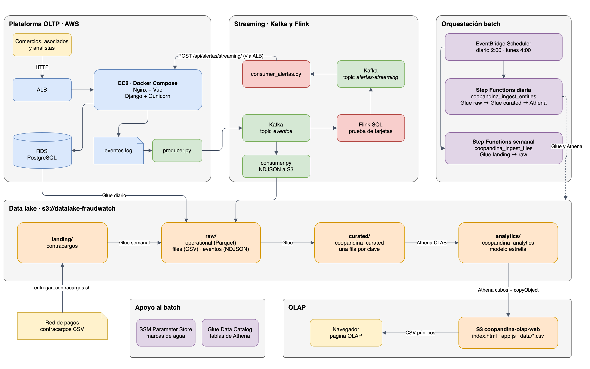

# Plataforma de detección de fraude de CoopAndina

Proyecto final de SI3008 Sistemas Intensivos en Datos. CoopAndina es una cooperativa ficticia que autoriza compras con tarjeta de crédito. La plataforma recibe esas compras en un sistema transaccional (OLTP), detecta en tiempo real ataques de prueba de tarjetas y lleva todos los datos a un data lake en AWS. Desde ahí, una página OLAP muestra cómo se comporta el fraude por categoría, ciudad, canal y tiempo.

## Qué hace la plataforma

| Funcionalidad | Cómo |
| --- | --- |
| Registrar las operaciones | La app OLTP guarda las compras en PostgreSQL y escribe cada operación de negocio en un log de eventos |
| Ingesta por streaming | Los eventos del log viajan por Kafka hasta la zona raw del data lake, a medida que ocurren |
| Procesamiento en streaming | Flink detecta pruebas de tarjetas sobre el flujo de eventos; el backend crea la alerta y bloquea el comercio |
| Ingesta batch de la base de datos | Glue extrae cada día lo nuevo de las tablas del OLTP hacia raw, de forma incremental |
| Ingesta batch de archivos | Glue toma cada semana los archivos de contracargos que entrega la red de pagos |
| Limpieza y unificación | Glue pasa cada fuente de raw a curated: una versión por registro, sin duplicados y con tipos correctos |
| Modelo analítico | Athena construye un modelo estrella en la zona analytics |
| OLAP | Athena calcula dos cubos y una página estática en S3 los muestra con filtros y gráficos |

## Fuentes de datos

| Fuente | Qué contiene | Llega por |
| --- | --- | --- |
| Base de datos del OLTP (RDS) | `asociados`, `comercios`, `tarjetas`, `autorizaciones` | Batch diario |
| Log de eventos de negocio | Una línea JSON por operación: autorizaciones, alertas, bloqueos, reclamos, inicios de sesión | Streaming |
| Archivos de contracargos | CSV semanal de la red de pagos, con el motivo de cada contracargo | Batch semanal |

Una autorización cuenta como fraude cuando tiene un contracargo con motivo `FRAUDE`.

## Arquitectura en la nube



## Cómo fluyen los datos

### Zonas del data lake

Todo vive en el bucket `datalake-fraudwatch`:

| Zona | Contenido | Formato |
| --- | --- | --- |
| `landing/` | Archivos tal como los entrega la red de pagos, antes de validarlos | CSV |
| `raw/` | Copia fiel de cada fuente, con columnas de control (`_ingested_at`, `_run_id`, etc.) | Parquet, NDJSON y CSV |
| `curated/` | Datos limpios: una versión por registro, sin duplicados y tipados | Parquet |
| `analytics/` | Modelo estrella listo para consultar | Parquet |

Las zonas `curated` y `analytics` están registradas en el Glue Data Catalog, en las bases `coopandina_curated` y `coopandina_analytics`, para consultarlas con Athena.

### 1. Ingesta por streaming: log de eventos → raw

1. Django escribe cada operación en el log de eventos, solo después de confirmar la transacción.
2. `producer.py` lee el log y publica cada línea en el topic `eventos` de Kafka.
3. `consumer.py` lee el topic y escribe los eventos en `raw/eventos/AAAA/MM/DD/HH/` como NDJSON.

Los dos corren como servicios systemd.

### 2. Procesamiento en streaming: detección de pruebas de tarjetas

1. Flink lee el topic `eventos` con `deteccion.sql`.
2. Agrupa las autorizaciones por comercio en ventanas de 5 minutos que avanzan cada minuto. Si en una ventana hay 3 o más tarjetas distintas con un monto promedio menor a 20.000, publica una alerta en el topic `alertas-streaming`.
3. `consumer_alertas.py` lee ese topic y llama a `POST /api/alertas/streaming/` con un usuario de rol `SERVICIO`.
4. El backend crea la alerta, bloquea el comercio en RDS y registra `ALERTA_CREADA` y `BLOQUEO_APLICADO` en el log. Esos eventos vuelven a entrar al flujo de streaming.

### 3. Ingesta batch de la base de datos: RDS → raw

Cada día, el job de Glue `glue_etl_coopandina` extrae cada tabla del OLTP por JDBC. La extracción es incremental: solo trae las filas con la marca de agua (`fecha_actualizacion`, o `fecha_hora` en autorizaciones) posterior a la última guardada en SSM Parameter Store. Escribe en `raw/operational/coopandina-postgresql/<tabla>/_ingestion_date=AAAA-MM-DD/_run_id=<id>/`.

### 4. Ingesta batch de archivos: landing → raw

La red de pagos deja cada semana un CSV de contracargos en `landing/contracargos/`. El job de Glue `glue_ingest_files_coopandina` valida la cabecera de cada archivo, lo copia a `raw/files/contracargos/` junto con un `_manifest.json` y mueve el original a `landing/_processed/`.

### 5. Raw → curated

El job de Glue `glue_curated_coopandina` se ejecuta una vez por fuente, lee toda la fuente en raw y reescribe su tabla en curated:

| Fuente | Qué hace |
| --- | --- |
| Tablas del OLTP | Deja la versión más reciente de cada registro y quita las columnas de control |
| Eventos | Descarta los registros inválidos, quita duplicados por `event_id` y particiona por fecha |
| Contracargos | Tipa las columnas y quita duplicados por `id_contracargo` |

### 6. Curated → analytics: modelo estrella

Athena construye cuatro tablas con `CREATE TABLE AS SELECT`, con las fechas en hora de Colombia:

| Tabla | Tipo | Contenido |
| --- | --- | --- |
| `hecho_autorizacion` | Hecho | Una fila por compra, con monto, canal, resultado y `es_fraude` (1 si tiene contracargo por fraude) |
| `hecho_alerta` | Hecho | Una fila por alerta, con su estado y los minutos que tardó en resolverse |
| `dim_tarjeta` | Dimensión | Franquicia y estado de la tarjeta, con la ciudad, edad e ingreso del asociado |
| `dim_comercio` | Dimensión | Nombre, categoría, ciudad y si vende en línea |

Cada corrida escribe en una carpeta nueva (`analytics/<tabla>/<run_id>/`) y reemplaza la tabla.

### 7. Analytics → OLAP

1. Athena ejecuta dos consultas cubo: `cubo_autorizaciones` (por año, mes, hora, categoría, ciudad, canal y franquicia) y `cubo_alertas` (por año, mes, tipo, estado y categoría).
2. Cada resultado se copia como CSV a `s3://coopandina-olap-web/data/`.
3. La página estática del mismo bucket descarga los CSV, los vuelve a agregar en el navegador según los filtros y dibuja los indicadores y gráficos con Chart.js.

### Orquestación

| Programación (EventBridge Scheduler) | Máquina de Step Functions | Pasos |
| --- | --- | --- |
| `coopandina-elt-daily`, todos los días a las 2:00 | `coopandina_ingest_entities` | Ingesta de las 4 tablas → curated de las 6 fuentes → las 4 tablas de analytics → los 2 cubos de la página |
| `coopandina-files-weekly`, los lunes a las 4:00 | `coopandina_ingest_files` | Ingesta de los archivos de landing a raw |

## Servicios utilizados

| Servicio | Para qué |
| --- | --- |
| Amazon EC2 | App OLTP, brokers de Kafka y Flink |
| Application Load Balancer | Entrada pública a la app y a la API |
| Amazon RDS for PostgreSQL | Base de datos del OLTP |
| Apache Kafka (en EC2) | Transporte de eventos y de alertas |
| Apache Flink (en EC2) | Procesamiento en streaming con Flink SQL |
| Amazon S3 | Data lake por zonas y hosting de la página OLAP |
| AWS Glue | Jobs de ingesta y de curated, con Spark y Python shell |
| AWS Glue Data Catalog | Metadatos de las tablas de curated y analytics |
| Amazon Athena | Modelo estrella y cubos con SQL |
| AWS Step Functions | Orquestación del batch |
| Amazon EventBridge Scheduler | Programación diaria y semanal |
| AWS Systems Manager Parameter Store | Marcas de agua de la extracción incremental |

## Cómo está organizado

```
backend/                      App OLTP: Django REST y el log de eventos
frontend/                     App OLTP: Vue 3
data-platform/
  ingestion/
    streaming/                Kafka, producer.py y consumer.py
    batch/
      operational/            Ingesta de RDS a raw
      files/                  Ingesta de archivos de landing a raw
      common/                 Código compartido por los jobs de ingesta
      orchestration/          Máquinas de Step Functions y programaciones
  processing/
    streaming/                Flink (deteccion.sql) y consumer_alertas.py
    batch/
      curated/                Job de raw a curated
      analytics/              Consultas del modelo estrella y de los cubos
olap-web/                     Página OLAP estática
scripts/                      Tráfico de demo y entrega de contracargos
```

## Cómo levantar cada parte

### App OLTP en local

Necesitas Docker.

```bash
cp .env.example .env
docker compose up --build
```

Los datos son el histórico de CoopAndina, construido a partir de un dataset de Kaggle. No está en el repositorio: pide al equipo el archivo `historico.zip`, descomprímelo en `backend/data/historico/` y cárgalo (usa la `CARGA_PASSWORD` de tu `.env` como contraseña de todos los usuarios):

```bash
docker compose exec backend python manage.py cargar_datos --dir data/historico
```

Entra a <http://localhost:5173> con `comercio_<nit>`, `asociado_<documento>`, `analista_demo` o `admin_demo`.

### Despliegue de la app en AWS

En la EC2, con `docker-compose.prod.yml`: Nginx sirve el build de Vue en el puerto 80 y reenvía `/api/`, `/admin/` y `/static/` a Gunicorn. El health check del ALB es `/healthz`. En el `.env` de la EC2 van `DJANGO_DEBUG=false`, `DJANGO_ALLOWED_HOSTS` con el DNS del ALB, `NUM_PROXIES=2` y `POSTGRES_HOST` con el endpoint de RDS.

```bash
docker compose -f docker-compose.prod.yml up -d --build
docker compose -f docker-compose.prod.yml exec backend python manage.py cargar_datos --dir data/historico
```

Carga el histórico antes de la primera ingesta batch: la de autorizaciones usa `fecha_hora` como marca de agua y, si corre antes, nunca tomará esas compras. Los contracargos del histórico (`backend/data/historico/contracargos/`) no van a RDS: se suben a `landing/contracargos/`.

### Ingesta por streaming

En `data-platform/ingestion/streaming/`, levanta Kafka con `docker compose up -d` e instala `producer-eventos.service` y `consumer-eventos.service` en systemd.

### Procesamiento en streaming

En `data-platform/processing/streaming/`, descarga el conector de Kafka y levanta Flink:

```bash
mkdir -p lib && curl -L -o lib/flink-sql-connector-kafka-3.4.0-1.20.jar https://repo1.maven.org/maven2/org/apache/flink/flink-sql-connector-kafka/3.4.0-1.20/flink-sql-connector-kafka-3.4.0-1.20.jar
docker compose up -d
docker compose cp deteccion.sql jobmanager:/opt/flink/deteccion.sql
docker compose exec jobmanager /opt/flink/bin/sql-client.sh -f /opt/flink/deteccion.sql
```

El job queda en la interfaz de Flink, en el puerto 8081. Si la máquina se reinicia, hay que volver a lanzarlo.

Para `consumer_alertas.py`, crea en el admin de Django un usuario con rol **Servicio**, guarda sus credenciales en `/home/ubuntu/consumer-alertas.env` (`API_USUARIO` y `API_PASSWORD`, con `chmod 600`), cambia `API_URL` en `consumer-alertas.service` por el DNS del ALB e instálalo:

```bash
sudo cp data-platform/processing/streaming/consumer-alertas.service /etc/systemd/system/
sudo systemctl daemon-reload && sudo systemctl enable --now consumer-alertas
```

Para probarlo de punta a punta, simula un ataque con `python3 scripts/demo_trafico.py --password <CARGA_PASSWORD> --prueba-tarjetas`.

### Batch

Los jobs de Glue se crean a partir de los `job.json` de cada carpeta, con los scripts en S3. Las máquinas de Step Functions están en `data-platform/ingestion/batch/orchestration/`, junto con sus programaciones. La máquina diaria necesita la RDS encendida.

Para simular la entrega semanal de contracargos generados desde la app:

```bash
bash scripts/entregar_contracargos.sh
```

### Página OLAP

Crea el bucket `coopandina-olap-web` con hosting estático y lectura pública, y sube `olap-web/index.html` y `olap-web/app.js`. La máquina diaria publica los cubos en `data/`.

## Log de eventos

Cada operación escribe una línea JSON en `/var/log/coopandina/eventos.log`, solo después de confirmar la transacción. En local queda en `logs/eventos.log`. Rota a diario y conserva 30 días. Nunca se registran el número completo de la tarjeta, el CVV, las contraseñas ni los valores de los datos personales que cambian.
